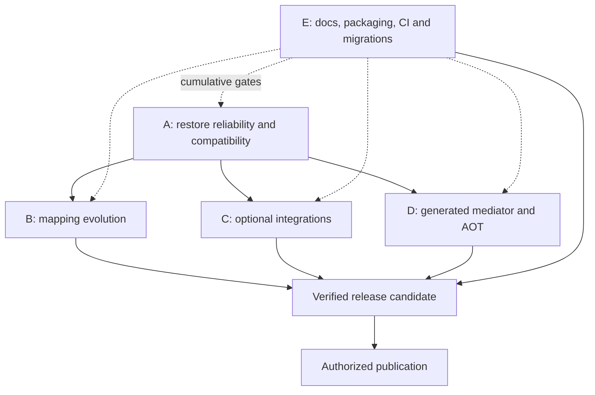

# Meridian Evolution Implementation Plan

> **For agentic workers:** REQUIRED SUB-SKILL: Use superpowers:subagent-driven-development (recommended) or superpowers:executing-plans to implement this plan task-by-task. Steps use checkbox (- [ ]) syntax for tracking.

**Goal:** Expand Meridian into a practical .NET toolkit while retaining verified behavior of every existing public feature.

**Architecture:** Keep both core packages independent and dependency-light. Repair the current baseline first; introduce opt-in generation and optional integrations in independently reviewed releases. Use a shared regression matrix and packed-consumer verification across every workstream.

**Tech Stack:** C#/.NET 8/9/10, netstandard2.0 Roslyn generators, xUnit/FsCheck, BenchmarkDotNet, optional FluentValidation/EF Core/ASP.NET Core/StackExchange.Redis adapters, GitHub Actions and NuGet validation.

**Spec:** [Portfolio design](../specs/2026-10-02-meridian-evolution-design.md), plus each workstream's linked design.

Status: planning complete after document self-review; all implementation tasks remain pending. Package numbers and calendar release dates are assigned only after actual publication baseline discovery and accepted scope.

## Global Constraints

- Keep existing APIs operational during documented deprecation windows; use additive replacements and reserve removals/default flips for a major release.
- Preserve runtime mapping defaults: DefaultMaxDepth=64, DefaultMaxCollectionItems=10000, AllowNullCollections=false, AllowNullDestinationValues=true, AllowUndefinedEnumValues=false.
- Preserve telemetry defaults: RecordExceptionMessage=false and RecordExceptionStackTrace=false; default notification publication remains sequential and concurrent publisher defaults remain capped at 16.
- Preserve existing generated method names and legacy assignment semantics; structural generation requires explicit opt-in.
- Core libraries continue targeting net8.0;net9.0;net10.0; generators target netstandard2.0; net11.0 preview coverage remains optional and non-blocking.
- Do not introduce FluentValidation, EF Core, Redis, ASP.NET Core, or telemetry-exporter dependencies into either core package.
- Preserve the reviewed dirty working tree; never reset, clean, stash, stage unrelated changes, or assume a worktree from HEAD includes the baseline.
- Publishing, tags, releases, external database changes, and new recurring monitors require explicit user authorization.
- Graph-Loop and Sol Advisor remain disabled; no workflow, custom agent, hook, or completion gate from either framework may be activated.

## Review Focus

1. A consumer using an older SDK or a public-interface implementation should still compile and load the packaged analyzer: A4 and E2.
2. Two independent applications/scopes should never share scoped services through static dispatcher caches: A7 and D2/D3.
3. A cyclic graph with equal-by-value nodes should retain reference identity and bounded traversal: A6 and B5/B8.
4. Cancellation or provider failure after a successful handler must not trigger duplicate side effects or erase the original error: A8 and C4/C5.
5. A new generated optimization must retain legacy collection aliasing, mapping limits, enum policy, and operation-option behavior: B2/B4/B6/B8.

## Execution sequence and gates

| Batch | Tasks | Deliverable | Gate to continue |
| --- | --- | --- | --- |
| 0 | A1 | Preserve and reproduce current working-tree baseline | Exact source manifest and trustworthy pre-change results |
| 1 | A2-A5 | Working examples, generator defect fixes, real property counts, consumer/package baseline | Seven samples pass; compiler probes pass; counts verified; API differences accounted for |
| 2 | A6-A8 | Existing mapping/mediator/behavior contracts protected | Current-applicable local legacy rows accepted with no known local regression; future-produced package/provenance checks and unavailable OS evidence remain cumulative E4/E5 release gates |
| 3 | B1-B7 | Expanded opt-in generated mapper and real SQL projections | Packaged generator consumer and runtime equivalence checks pass |
| 4 | C1-C6 | Validation, cache, leased idempotency, transactions, HTTP example | Real provider integration and scoped-lifetime checks pass |
| 5 | D1-D5 | Generated mediator registry, AOT execution, diagnostics, metrics | AOT binary runs requests, notifications, and streams with required behaviors |
| 6 | B8 and E1-E4 | Nested optimization, complete docs, fair benchmarks, release manifest | No behavior/allocation regression; claims match measured support |
| 7 | E5-E7 | Release preparation/promotion, deprecation lifecycle, and maintainable operations | Exact packages, provenance, migration/support matrix, maintainer instructions verified; promotion requires authorization |

B and C can overlap after A8 if file ownership is disjoint. D can overlap adapter work after its legacy/scoped contracts pass. B8 must follow B6/B7; optimizing before those contracts exist would obscure failures. A4 creates E's initial core-only package manifest; E2 extends the same inventory before the first optional package is packed. E1 documentation follows each accepted feature. E7 prepares migration guidance early, but warnings/removal wait for actual stable replacement eligibility. Final E gates are cumulative.

The implementation set contains 34 tasks: A1-A8, B1-B8, C1-C6, D1-D5, and E1-E7. Each child plan defines files, contracts, tests, commands, and commit boundaries. This document is orchestration, not permission to execute all tasks in one unchecked batch.

## Workstream plans

- [A — Reliability and compatibility](2026-10-02-reliability.md)
- [B — Mapping evolution](2026-10-02-mapping.md)
- [C — Optional integrations](2026-10-02-integrations.md)
- [D — Mediator AOT and diagnostics](2026-10-02-mediator.md)
- [E — Documentation and distribution](2026-10-02-distribution.md)
- [Existing-feature regression matrix](2026-10-02-regression-matrix.md)

## Task completion policy

For each task: read its design and interfaces; add the named behavioral test; demonstrate its pre-change failure or unsupported state; implement the smallest change; run targeted checks and affected legacy rows; review; commit only task-owned changes. For documentation or manifest tasks, validate links/schema/package output instead of inventing unit tests that mirror text.

Every evidence entry records candidate commit plus dirty-source hash if applicable, SDK/runtime, OS/architecture, exact command, test counts including skipped cases, artifact hashes, and limitations. The reviewed baseline contains uncommitted changes; do not silently drop them when preparing a worktree. Never rewrite baseline tests merely because a new path fails them.

Use the code graph first for discovery, recheck generation and candidate coverage before each task, and directly read any missed source. Both optional frameworks named in the user instructions remain disabled.

## Release strategy

First release candidate: A only, with sample and generator correctness repair and truthful verification. Next candidates: B's additive generated mapping and C's independent adapters; runtime APIs remain compatible. D's AOT claim ships only after D4. E packaging/doc gates apply to every candidate, rather than only the last batch.

Before assigning a minor/patch version, compare the current security hardening with the actual previous stable package. Defaults changed in the existing uncommitted work need explicit migration and security justification, or an appropriate major version. A passing API diff does not establish behavioral compatibility.

Rollback uses a previously verified package or an opt-in feature switch. Preserve completed idempotency records and cache key schema/version choices; rolling back code must not silently reinterpret provider data. Do not automate rollbacks of external business side effects.

## Estimates

Planning bands for one experienced implementer with review time: A 5-8 working days; B 10-18; C 10-16; D 7-12; E 4-7, with documentation overlapping other work. Approximately 7-12 working weeks sequentially; this is a planning estimate, not a commitment. A supplies the first useful delivery and refreshes estimates using actual failures and compiler/provider compatibility. Infrastructure availability and required independent review add calendar time.

## Review and handoff

- [ ] Approve the portfolio constraints and subsystem designs.
- [ ] Select subagent-driven or native execution.
- [ ] Start A1; do not start expansion before A's acceptance gate.
- [ ] Record acceptance of each task and regression row.
- [ ] Authorize release actions separately once a concrete candidate is ready.

Recommended execution: subagent-driven for implementation, with explicit file ownership, review after each independently testable task, and a final full-branch review. The public APIs, generators, and provider semantics make independent review useful. Native execution remains available with a full independent review at the end.
